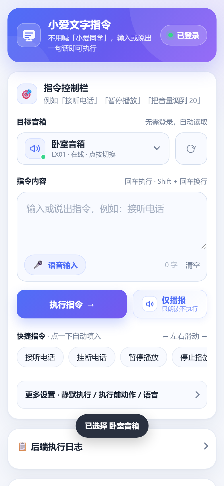
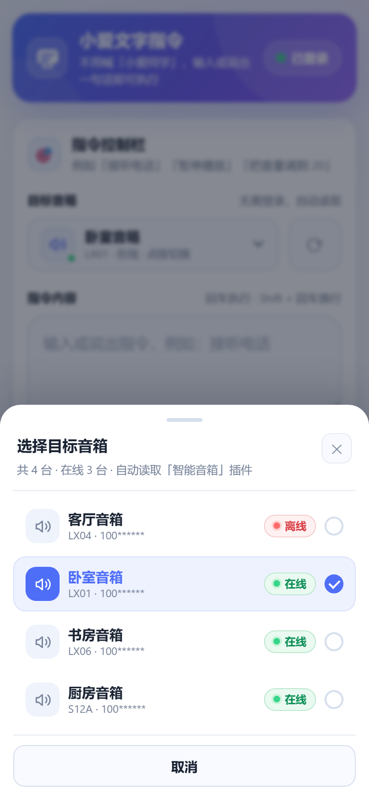
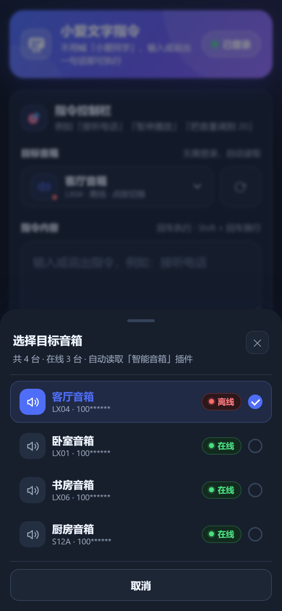

# 小爱文字指令 · xiaoai-cmd

> 一个 Songloft `.jsplugin` 插件：**不用喊「小爱同学」、不用麦克风**，在页面输入（或说出）一句话，让小爱音箱像听到这句话一样直接执行。

| 项目 | 值 |
| --- | --- |
| 当前版本 | **2.0.2** |
| 插件名称 / 标识 | `小爱文字指令` / `xiaoai-text-command` |
| 宿主要求 | Songloft ≥ 2.9.5 |
| 插件源地址 | <https://raw.githubusercontent.com/yaoxipenga/xiaoai-cmd/main/registry.json> |
| 安装包 | <https://raw.githubusercontent.com/yaoxipenga/xiaoai-cmd/main/xiaoai-text-command.jsplugin.zip> |
| 许可证 | MIT |





---

## 1. 这是什么

在插件控制栏输入「接听电话」「暂停播放」「把音量调到 20」，目标音箱会**执行这条指令**，而不是把这几个字念出来。也可以点「仅播报」只朗读文字，或点「🎤 语音输入」说完自动转成文字填入输入框。

和另外两个官方插件的区别：

| 插件 | 做的事 | 是否执行新指令 |
| --- | --- | --- |
| 远程呼唤（文字模式） | `mibrain/text_to_speech`，把文字**朗读**出来 | 否 |
| 小爱语音助手 | `/conversation/ws` **监听**小爱已经识别出的对话文本 | 否 |
| **本插件** | 默认云端文本指令 `mibrain/ai_service`；MIoT `5-4` 仅作实验通道 | **是** |

---

## 2. 安装

### 2.1 通过插件源（推荐）

在 Songloft「设置 → 导航与插件 → 提交插件源」里填入：

```
https://raw.githubusercontent.com/yaoxipenga/xiaoai-cmd/main/registry.json
```

商店会读取 `registry.json` → `plugin.json` → `manifest.json` / zip，按版本号提示安装与更新。

### 2.2 手动上传安装包

下载仓库根目录的 [`xiaoai-text-command.jsplugin.zip`](https://raw.githubusercontent.com/yaoxipenga/xiaoai-cmd/main/xiaoai-text-command.jsplugin.zip)，在「插件 → 手动上传安装包」中选择该文件即可，不需要先配置任何账号。

> `name` 与 `entryPath` 从 1.0.0 起保持不变，因此**上传新版本会原地升级**，已保存的设备偏好、指令日志和配置都会保留。

---

## 3. 界面与功能（2.0.0 起）

- **移动端 / App 优先**：指令文本框独占整行（最小 100px 高、16px 字号避免 iOS 聚焦缩放），「执行指令 / 仅播报」移到文本框下方独立一行；自动适配系统暗色、底部安全区、App 内置 WebView；360px 起的窄屏无横向溢出。
- **自定义弹出选择器**：「目标音箱」「执行前」不再是系统原生单选框。手机端从底部滑出 Bottom Sheet，桌面端（≥640px）自动变居中对话框；支持点遮罩 / ✕ / 取消 / ESC 关闭，打开时锁定页面滚动。
- **设备在线状态**：状态取自宿主 `/mina/devices` 的 `presence`，与顶部「已登录」状态灯同一套视觉语言。

  | `presence` | 弹层状态胶囊 | 选择框图标角标 |
  | --- | --- | --- |
  | `online` | 🟢 在线（绿点 / 浅绿底） | 绿点 |
  | `offline` | 🔴 离线（红点 / 浅红底） | 红点 |
  | 空 / 其它 | ⚪ 未知（灰点） | 灰点 |

  顶部「已登录」表示**小米账号凭据**是否可用，设备状态表示这台**音箱本身**是否在线，两者互不影响。状态只用于展示，不影响指令下发。

- **语音输入**：优先使用浏览器 Web Speech API（`zh-CN`），识别结果实时填入输入框；若 App 宿主注入了原生语音识别桥接会自动接上；iOS Safari / 不支持的 WebView 会提示改用输入法键盘的 🎙 系统听写。可选「识别后自动执行」（默认关闭以免误触）。
- **执行前动作**：不做处理 / 停止当前播放 / 音量调低到 10%；另有「静默执行」（云端通道通过 `tts:0` 生效）。
- **执行日志**：逐条记录实际调用的通道、HTTP 状态与云端返回码，便于区分凭据问题与机型固件限制。

---

## 4. 为什么「打开即用、不用再登录」

Songloft 的 `songloft.storage` 按插件隔离，插件之间读不到彼此的账号；但插件可以调用宿主「智能音箱」插件的 HTTP 路由，并用它返回的 `passToken` 换取自己的 `serviceToken`：

| 能力 | 通道 | 需要额外登录吗 |
| --- | --- | --- |
| 列出所有音箱 | `/api/v1/jsplugin/miot/mina/devices` | 否 |
| 执行前停止播放 / 调音量 / 播报 | `/api/v1/jsplugin/miot/mina/*` | 否 |
| 已登录账号的 `passToken` | `/api/v1/jsplugin/miot/accounts` | 否，自动复用 |
| `micoapi` / `xiaomiio` 的 `serviceToken` | 用 `passToken` 走官方 `serviceLogin` 流程向 `account.xiaomi.com` 换取 | 否，自动完成 |

官方 `/accounts` 只对 `service_token` / `ssecurity` 脱敏，`passToken` 完整返回。换取流程与官方 `MinaAuth.exchangeServiceToken` 同构：`serviceLogin` → `clientSign = base64(sha1("nonce=<nonce>&<ssecurity>"))` → 从 STS 响应的 `Set-Cookie` 取 `serviceToken`。token 只在内存缓存 30 分钟，过期自动重换；官方插件刷新 token 后无需任何操作。

兼容兜底（仅主通道不可用时）：`command.exec` 读取本机 `accounts` 文件、共享 storage 扫描、页面「高级设置」手动导入。

---

## 5. 指令是怎么执行的

1. **云端 `mibrain / ai_service`**（默认 / 主）：`POST https://api2.mina.mi.com/remote/ubus`，`message = {tts:1, nlp:1, nlp_text:"…"}`。需要 `micoapi` 的 `serviceToken`。这批机型（LX04 / LX01 / LX06 / S12A）实机验证能正常执行。**注意**：它是云端远程文本代理，只注入一次远程 NLP 会话；下发「接听电话」能接听、能播放下行声音，但麦克风上行没有交给通话模块，通话会变成单向。
2. **MIoT `5-4` execute-text-directive**（实验，默认关闭）：官方动作 `siid=5, aiid=4`，参数 `[文本, 静默标志]`，语义上等同直接对小爱说出这句话。需要 `xiaomiio` 的 `serviceToken` + `ssecurity` 与设备 `miotDID`。**实机教训**：云端返回 `code=0` 只代表「已受理」，上述老机型设备实际并不执行动作；因此默认不调用，只有 `POST /command` 显式带 `channel:"miot"` 时才尝试。宿主的 `/mina/devices` 不返回 `miotDID`，插件仍会从米家云 `admin/v2/device_list` 补全并缓存 6 小时，仅供该实验通道使用。
3. **宿主控制通道**（兜底）：停止播放、降低音量、TTS 播报，零凭据即可用。

云端通道会把 HTTP 状态与返回码逐条写入页面执行日志。**判断指令是否真的生效，要看设备端有没有反应，不能只看 `code=0`。**

---

## 6. 后端 API

页面统一请求 `BASE = /api/v1/jsplugin/xiaoai-text-command`：

| 方法 | 路径 | 用途 |
| --- | --- | --- |
| GET | `/health` | 登录态、凭据来源、可用通道自检 |
| GET | `/devices` | 列出宿主已登录账号下的全部音箱 |
| POST | `/command` | 下发指令；`say_only=true` 时仅播报，`channel="miot"` 时实验性走 5-4 |
| GET / POST | `/config` | 读取 / 保存（或清空、导入）手动凭据 |
| POST | `/redetect` | 重新同步宿主登录态 |
| POST | `/test` | 凭据自检 |
| GET | `/logs` | 读取执行日志 |
| POST | `/logs/clear` | 清空执行日志 |

`channel` 是 v2.0.2 新增的可选字段，只接受 `cloud`（默认，云端文字指令）与 `miot`（实验性 5-4）。日常使用不需要传，前端界面也不暴露该开关；页面总是按默认通道下发。

---

## 7. 插件源规范与双层哈希

```
registry.json   →  plugin.json  →  manifest.json（更新检查）
                                 →  xiaoai-text-command.jsplugin.zip（安装包）
```

- `registry.json`：插件源入口，`plugins` 数组列出 `plugin.json` 的 raw 地址。
- `plugin.json`：插件元数据 + `entryPath` + `permissions` + `updateUrl` / `download_url` + 双层哈希。
- `manifest.json`：商店用来比对版本与哈希的更新清单。
- zip 内只包含 `plugin.json`、`main.js`、`static/index.html`、`static/icon.svg`。

哈希算法与宿主 `internal/jsplugin/hash.go` 一致，由 `build.py` 计算并写回两个 json：

```
entryHash = sha256(zip 内 main.js 的原始字节)
zipHash   = sha256( 对 zip 内所有非 plugin.json 文件按路径升序，
                     逐条拼接 "<path>\n<sha256Hex(content)>\n" )
```

> `plugin.json` 自身不参与 `zipHash`，所以重算哈希写回元数据不会造成循环依赖。

ZIP 通过仓库内 raw 地址分发，**push 完立刻可安装**，不需要额外创建 GitHub Release。若以后改用 Releases，把 `plugin.json` / `manifest.json` 的 `download_url` 换成 Release Asset 地址并重新运行 `build.py` 即可。

---

## 8. 目录结构

```
xiaoai-cmd/
├── registry.json                     ← 插件源（表单要的 URL）
├── plugin.json                       ← 插件元数据 + 双层哈希
├── manifest.json                     ← 更新检查清单
├── xiaoai-text-command.jsplugin.zip  ← 随仓库发布的安装包
├── main.js                           ← 插件后端
├── static/
│   ├── index.html                    ← 控制栏页面（无 CDN、无外部字体）
│   └── icon.svg                      ← 插件图标
├── docs/                             ← README 预览图
├── build.py                          ← 重算哈希 + 打包 / 自检
├── publish.ps1                       ← 换仓库地址 + 构建 + 推送
├── .gitignore                        ← 排除凭据类文件
└── README.md
```

---

## 9. 本地开发与发布

```bash
# 改完代码后：先改 plugin.json / manifest.json 的版本号，再执行
python build.py            # 重算双层哈希、重新打包、从成品 zip 反算校验
python build.py --check    # 只校验，不写文件（CI / 提交前可用）
python build.py --sync-dev # 额外同步到 ./xiaoai-text-command.jsplugin/
```

然后 `git add . && git commit && git push`，商店按版本号提示更新。

**换自己的仓库**：运行 `powershell -ExecutionPolicy Bypass -File .\publish.ps1 -GitHubUser 你的用户名 -Repo 你的仓库名`，脚本只替换发布 URL（不会误伤 `entryPath` 与 zip 文件名），重算哈希后提交推送，并打印新的插件源 URL。加 `-NoPush` 可只准备文件不推送。

> 手动上传 zip 做本地测试时，若想和已装版本并排对比，改 `plugin.json` 的 `name` / `entryPath` 并同步修改 `static/index.html` 里的 `BASE`，再运行一次 `build.py`。

---

## 10. 账号与凭据安全

- 本仓库（**含全部提交历史**与可分发的 zip）不包含任何账号、密码、`serviceToken`、`passToken`、`ssecurity`，也不包含任何 Songloft 实例地址。源码里出现的这些词只是字段名、运行时变量与说明文字，真实值在插件运行时才从宿主取得。
- 插件**不把小米凭据写进磁盘**：`passToken` 换取的 token 仅在内存缓存 30 分钟；插件 storage 只保存指令日志和用户手动填写的配置。
- 所有携带凭据的请求只发往小米官方域名（`account.xiaomi.com`、`api2.mina.mi.com`、`api.io.mi.com`），不发往本仓库、作者或任何第三方服务器。
- `.gitignore` 已排除 `accounts`、`.env`、`*token*.txt`、`*secret*`、`xtc_*.json` 等常见凭据文件；提交前请确认没有把这类文件加入 git。
- GitHub 提交历史里的邮箱只是提交者元数据，不是任何服务的登录凭据；如不想公开可在 GitHub 设置里启用私密提交邮箱。
- 若你曾把管理员密码或设备授权码提供给他人做排查，建议事后修改密码并撤销对应授权。

---

## 11. 验证记录

**后端（v1.1.0 实机，2026-11-23）**：Songloft 宿主 + 官方「智能音箱」插件，账号已扫码登录，4 台音箱（LX04 / LX01 / LX06 / S12A）。

- 清空手动导入的凭据后，`/health` 仍返回 `has_credentials=true, reused=true, credential_source=auto, auto_accounts=1`，即真正零配置。
- 设备列表自动带出全部 4 台音箱。
- 「现在几点」「接听电话」「暂停播放」「音量调到 20」（含静默模式）全部返回 `code=0`。
- 这些设备不返回 `miotDID`，MIoT `5-4` 自动跳过，云端 NLP 通道成功执行；`silent` 通过 `tts:0` 生效。

**前端（v2.0.0，本地无头浏览器）**：

- 真实 390px 手机视口 33 项交互自测全通过：在线 / 离线 / 未知三态、浅色与暗色配色、在线台数统计、选中后选择框联动、执行前弹层不出现状态胶囊、指令仍可下发、弹层开关与 ESC / 遮罩关闭。
- 10 个视口（320 → 1280px）全元素几何扫描无新增溢出；与上一版做逐像素布局对照，主要控件位置一致。
- `node --check` 语法通过，58 个 DOM id 引用零缺失。

**后端（v2.0.1 / v2.0.2 实机，2026-11-23）**：同一套 Songloft 宿主 + 4 台音箱，重点验证通道选择。

- 宿主的 `/mina/devices` 不返回 `miotDID`，但米家云 `admin/v2/device_list` 的原始返回里有（例如 LX06「鑫宝詹森之家」= `725764854`）。
- **v2.0.1 的教训**：默认切到 MIoT 5-4 后，「关闭鱼缸」「音量调到 40」等指令云端全部 `HTTP 200 / code=0`，但音箱没有任何反应 —— `code=0` 只代表「已受理」，这批老机型并不执行该动作。
- 传无效 DID 时 MIoT 返回 `code=-8 / get udid error=0`，可用来强制回退到云端通道做对照。
- **v2.0.2 恢复验证**：默认回到 `mibrain/ai_service`；模拟页面真实请求（带 `miot_did`、不带 `channel`）返回 `channel=mibrain/ai_service`、`code=0`，执行日志中不再出现 5-4 步骤。
- 通话单向问题**尚未解决**：通过云端文本代理下发「接听电话」能接听、下行有声，但音箱侧麦克风上行传不回；直接对音箱说「小爱同学，接听电话」则双向正常。

---

## 12. 已知限制

- 不同机型 / 固件对文本指令动作的开放程度不一致，老款（如小爱音箱 mini）可能返回非 0 错误码；页面日志会给出具体返回码。
- 「接听 / 挂断电话」还要求音箱本身已绑定通话功能。
- 网页语音识别在 **iOS Safari 与部分 App 内置 WebView 不可用**，会自动降级为键盘系统听写提示。
- 设备在线状态完全依赖宿主 `/mina/devices` 返回的 `presence`；若宿主未提供该字段，会显示灰色「未知」而不是猜测。
- 若云端通道被拒，可勾选「执行前停止播放」并用「仅播报」提示，或在米家 App 里建立手动场景用小爱口令触发。
- **MIoT 5-4 在老机型上不可用**：LX04 / LX01 / LX06 / S12A 会返回 `code=0` 却不执行动作，因此默认不启用；`channel:"miot"` 只供实验排查。
- **「接听电话」会单向**：`mibrain/ai_service` 是云端远程文本代理，注入的是一次远程 NLP 会话，接听后只建立下行播放，麦克风上行不会交给通话模块。需要双向通话请直接对音箱说「小爱同学，接听电话」、按音箱顶部按键接听，或在米家 App 里开启自动接听。

---

## 13. 更新日志

### v2.0.2（2026-11-23）

- **回退修复**：v2.0.1 把默认通道切到 MIoT 5-4 后，老机型音箱对所有指令都没反应。现在默认恢复 `mibrain/ai_service`，5-4 降级为 `channel:"miot"` 实验参数，默认完全不调用、也不产生额外请求。
- 新增从米家云 `admin/v2/device_list` 补全 `miotDID`（缓存 6 小时），只影响 `/devices` 返回字段，供实验通道使用。
- 前端与既有 API 契约不变；`entryHash` / `zipHash` 已重算，`build.py --check` 校验通过。
- 文档补齐通道选择、实机验证记录，以及「接听电话单向」「`code=0` ≠ 设备执行」两条已知限制。

### v2.0.1（2026-11-23）· 未发布，已废弃

- 曾尝试自动补全 `miotDID` 并默认走 MIoT 5-4，期望解决「接听电话单向」。实机发现这些机型只受理不执行，导致所有指令失效，已在 v2.0.2 回退。**请勿使用该版本。**

### v2.0.0（2026-11-23）

- 前端整体重构：移动端 / App 优先布局、文本框独占整行、按钮下移、渐变头图与卡片、暗色适配、安全区留白。
- 新增 🎤 语音输入（自动转文字填充，含 App 原生桥接与系统听写降级）。
- 两个原生下拉改为自定义弹出选择器（手机 Bottom Sheet / 桌面居中对话框）。
- 新增设备在线 / 离线 / 未知状态标识（状态胶囊 + 图标角标 + 在线台数统计）。
- 「仅播报」按钮重做；顶部状态灯简化为「已登录 / 未连接」；设置与日志折叠。
- 后端 `main.js` 与 API 契约保持不变，`entryHash` 与 v1.1.0 相同。

### v1.1.0

- 改为读取宿主 `/accounts` 的 `passToken` 换取 `serviceToken`，实现真正零配置；不再依赖本机 `accounts` 文件读取。实机 4 台音箱验证通过。

### v1.0.0

- 初版：免唤醒文字指令下发，插件源规范、双层哈希与一键发布脚本。

---

## 14. License

MIT — 详见 `plugin.json` 的 `license` 字段。
